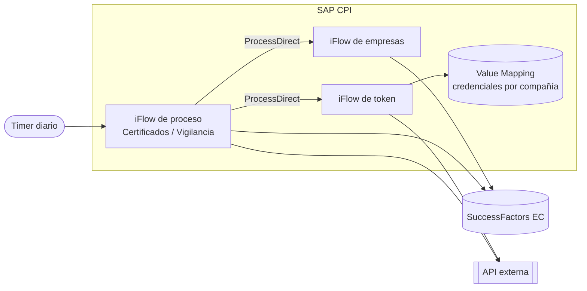
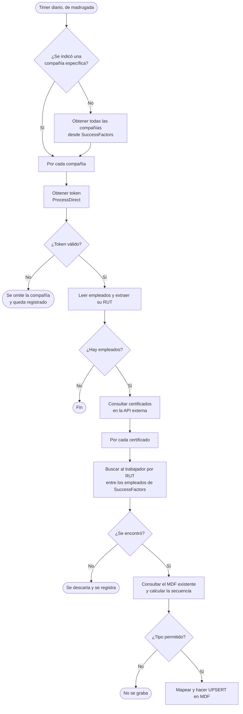
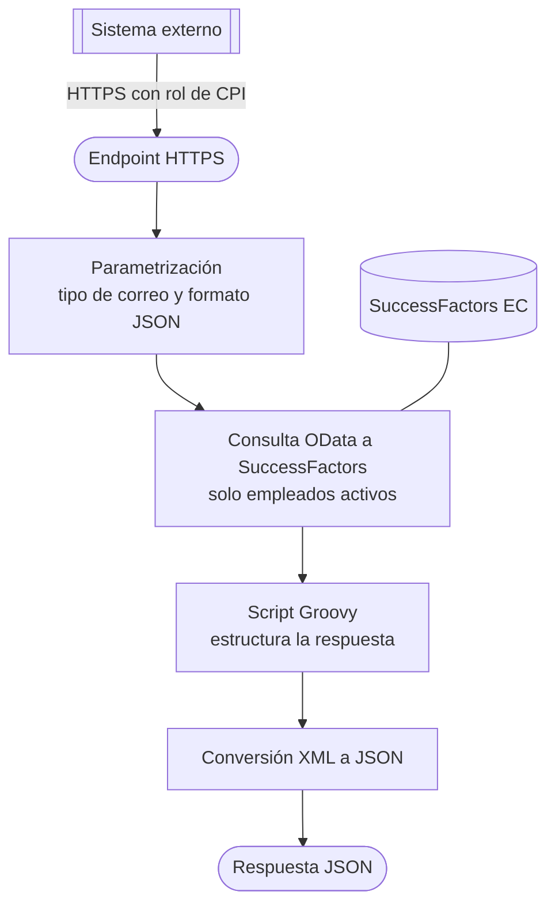

Dos soluciones que cubren las dos direcciones de una integración: **consumir** una API externa para grabar datos en SuccessFactors, y **exponer** datos de SuccessFactors como una API.

El cliente y la entidad externa están anonimizados, y no se muestran nombres de iFlows, URLs, credenciales ni datos de personas.

## Proyecto 1: sincronización con una API externa de salud ocupacional

Un proceso en **SAP CPI** que, cada madrugada, trae certificados de exámenes y resultados de vigilancia médica desde una API externa y los graba en objetos personalizados **MDF** de SuccessFactors Employee Central.

**Qué resuelve.** Esa información vivía solo en el sistema externo y había que consultarla y cargarla a mano. La integración:

- trae los datos de cada compañía y los **asocia al trabajador correcto** usando su RUT,
- los graba **sin duplicar** registros aunque el proceso se reejecute,
- funciona para **varias compañías** con credenciales distintas, sin duplicar iFlows.

### Arquitectura

Seis artefactos separados por responsabilidad; los procesos principales se conectan con los auxiliares mediante **ProcessDirect**.

Los procesos leen empleados y graban los MDF en SuccessFactors, y consultan certificados y resultados en la API externa; el iFlow de token se encarga solo de autenticarse contra ella.

| Artefacto | Responsabilidad |
|---|---|
| iFlow de empresas | Consulta las compañías en SuccessFactors y las expone por ProcessDirect para reutilizarlas |
| iFlow de token | Obtiene el token OAuth2 de la API externa para una compañía concreta |
| Value Mapping | Guarda, por compañía, los parámetros de autenticación y conexión |
| iFlow de certificados | Proceso diario: lee empleados, consulta certificados, los empareja y los graba en el MDF |
| iFlow de certificados (carga masiva) | Variante para cargas históricas por rango de fechas, ejecutada una sola vez |
| iFlow de resultados de vigilancia | Proceso diario equivalente, con otro MDF de destino |

### Flujo del proceso diario

1. **Disparo y alcance.** Un timer diario inicia el proceso. Un parámetro permite ejecutarlo para una sola compañía (útil para reprocesos) o para todas.
2. **Autenticación por compañía.** Las credenciales salen del Value Mapping y el iFlow de token obtiene el token OAuth2.
3. **Lectura de empleados.** Se leen con su documento de identidad y, mediante XSLT, se extrae solo el RUT.
4. **Consulta a la API externa**, con el rango de fechas como parámetro.
5. **Emparejamiento por RUT** de cada certificado con su empleado.
6. **Grabado sin duplicados** (ver decisiones técnicas).
7. **Trazabilidad:** cada etapa deja adjuntos en el monitor de mensajes, identificados por compañía.

### Resultados de vigilancia médica

Mismo patrón, con estas diferencias:

- La respuesta llega en formato **OData (Atom)** y se transforma con **XSLT** a una estructura plana.
- Las fechas llegan en formato *epoch* (`/Date(1700000000000)/`). Un script Groovy las convierte a fecha local en la zona horaria **America/Santiago**, para que el día no se desplace por el cambio de huso.
- Si un RUT de la respuesta no existe en SuccessFactors, queda un log claro y el proceso **continúa con el resto**.
- El destino es un MDF distinto, con su propio mapping de campos.

### Decisiones técnicas

**Un iFlow de token reutilizable.** La autenticación vive en un solo iFlow expuesto por ProcessDirect: un cambio se hace en un lugar y todos los procesos lo heredan. Los parámetros del formulario se codifican en URL con un script antes de enviarse como `application/x-www-form-urlencoded`.

**Credenciales por compañía en Value Mapping.** La clave combina el código de compañía con un sufijo de país y se leen todos los valores en una sola pasada. Sumar una compañía es **agregar filas al Value Mapping**, sin tocar ni redesplegar ningún iFlow. Si falta un valor obligatorio, el script falla con un error que indica la compañía, en lugar de seguir con datos incompletos.

**Emparejamiento robusto por RUT.** El RUT llega en formatos distintos entre sistemas: con o sin puntos, con o sin cero inicial, y con dígito verificador `K` en mayúscula o minúscula. La lógica quita los puntos, prueba también con un cero a la izquierda y, en la carga masiva, normaliza a mayúsculas para no perder trabajadores cuyo dígito verificador es `K`.

**Grabado sin duplicados (idempotencia).** Los MDF con varios registros por empleado usan una secuencia de transacción. El script busca en el MDF un registro con el mismo **folio**: si existe, **reutiliza su secuencia** y actualiza; si no existe, toma la **última secuencia más uno** y crea; si el empleado no tiene registros, empieza en 1. Reejecutar el proceso o repetir una ventana de fechas no genera duplicados.

**Carga masiva separada del proceso diario.** La carga histórica reutiliza la lógica con otra configuración: se ejecuta **una sola vez** y con un rango de fechas por parámetros, así se puede cargar por períodos acotados para no saturar la API ni CPI.

**Todo parametrizado.** URLs, tipo de autenticación, credenciales y fechas son parámetros externalizados, así que el mismo paquete pasa de pruebas a producción cambiando solo la configuración.

### Manejo de errores y observabilidad

| Situación | Cómo se maneja |
|---|---|
| Credenciales incompletas para una compañía | Error explícito con la compañía; no se consulta la API |
| Sin token | Se omite esa compañía sin detener a las demás |
| Compañía sin empleados | La rama termina sin llamar a la API |
| Certificado o paciente sin empleado en SuccessFactors | Se descarta con un log que indica el RUT no encontrado |
| Caracteres especiales de la conversión JSON a XML | Un script los limpia antes de procesar |
| Seguimiento en operación | Adjuntos en el monitor de CPI con request y response de ambos sistemas, por compañía, y la cantidad de certificados recibidos |
| Nivel de log | Un parámetro activa los logs detallados solo cuando se necesitan |

## Proyecto 2: API de empleados expuesta desde SuccessFactors

Un iFlow que publica un **endpoint HTTPS** para que un sistema externo consulte los **empleados activos** de SuccessFactors. En lugar de que el consumidor entienda la estructura de SuccessFactors, recibe un **JSON simple y estable** con solo lo que necesita.

**Qué resuelve.** SuccessFactors devuelve respuestas muy anidadas (persona, datos personales, correos, puesto, unidad de negocio) con cientos de campos. El iFlow actúa como **capa de traducción**: consulta lo necesario, limpia y entrega un contrato corto.

1. **Entrada segura.** El endpoint exige autenticación basada en roles de CPI y tiene protección CSRF activada.
2. **Parametrización.** Fija la respuesta como JSON y toma de un parámetro **qué tipo de correo** entregar (corporativo o personal), sin tocar código.
3. **Consulta OData** a `EmpEmployment`, expandiendo persona, datos personales, correos, puesto y unidad de negocio, con un filtro que deja **solo empleados activos**. El filtro se aplica en el servidor de SuccessFactors, no en CPI, para mover menos datos.
4. **Script Groovy** que reduce la respuesta a un objeto plano por empleado.
5. **Conversión a JSON** y respuesta al consumidor.

### Lógica de transformación

| Campo entregado | Cómo se obtiene |
|---|---|
| `Codigo` | Identificador del empleado en SuccessFactors |
| `Nombres` | Nombre de pila |
| `Apellidos` | Apellido paterno y materno, unidos solo si existen (navegación segura para no fallar con nulos) |
| `Fecha_Nacimiento`, `Fecha_Ingreso` | Se quita la parte de hora y queda solo la fecha |
| `Email` | Entre todos los correos de la persona, el del **tipo configurado**; si no existe, devuelve vacío en vez de fallar |
| `Cod_Cargo`, `Txt_Cargo` | Código y título del puesto |
| `Cod_Gerencia`, `Txt_Gerencia` | Unidad de negocio y su descripción |

**Control de calidad de datos.** Un empleado solo se incluye si tiene documento de identidad, nombre y apellido, para que el sistema externo no reciba registros incompletos.

### Decisiones técnicas

- **Contrato propio en lugar de exponer SuccessFactors tal cual.** El consumidor depende de un formato estable aunque cambie el modelo de origen.
- **Tipo de correo como parámetro.** Pasar de correo corporativo a personal es un cambio de configuración.
- **Valores seguros por defecto.** Si falta el correo o el segundo apellido, el flujo sigue y devuelve vacío; solo se excluye lo realmente inválido.
- **Credenciales y URL externalizadas**, para mover el mismo iFlow entre ambientes.

## Stack

SAP CPI · iFlows · HTTPS Sender · ProcessDirect · Timer · Splitter y Gather · Router · Message Mapping · XSLT · Groovy · Value Mapping · SuccessFactors OData v2 · MDF · OAuth2 · JSON y XML
