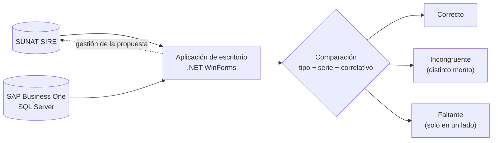

## El problema

Cada periodo, la empresa debe cotejar la propuesta que genera SUNAT en el SIRE con los comprobantes registrados en su ERP. Hacerlo a mano, con archivos y hojas de cálculo, es lento y es fácil que se escape una diferencia.

## La solución

Una aplicación de escritorio que reúne las dos fuentes y las compara:

- **Consulta SUNAT:** carga los ejercicios y periodos disponibles, la fase de cada periodo y la propuesta de comprobantes.
- **Consulta SAP Business One:** obtiene los comprobantes registrados en el ERP, incluidos los anulados.
- **Compara por tipo, serie y correlativo** y marca cada comprobante como *Correcto*, *Incongruente* (existe en ambos lados con distinto monto) o *Faltante* (está en un lado y no en el otro).
- **Cubre ventas y compras**, y en compras también los no domiciliados.
- Incluye las acciones de gestión de la propuesta: aceptar, reemplazar, eliminar y ajuste de periodos.

## Recorrido

<figure>
  
  <figcaption>Menú principal: ventas, compras y credenciales de SUNAT.</figcaption>
</figure>

### SIRE Ventas

1. **Elegir el ejercicio.** Los ejercicios disponibles se cargan desde SUNAT.
2. **Elegir el periodo.** Al seleccionarlo se consulta su fase (por ejemplo, *Generación de Registro*).

<figure>
  
  <figcaption>Año y periodo seleccionados; la aplicación consulta la fase del periodo.</figcaption>
</figure>

3. **Ver la propuesta de SIRE.** Lista los comprobantes de la propuesta de SUNAT.

<figure>
  
  <figcaption>Vista SIRE: comprobantes de la propuesta de SUNAT.</figcaption>
</figure>

4. **Ver lo registrado en SAP.** Lista los comprobantes del ERP; los anulados se identifican como tales.

<figure>
  
  <figcaption>Vista SAP: comprobantes del ERP, con los anulados marcados.</figcaption>
</figure>

5. **Comparar.** Cruza ambos lados y muestra los totales de cada uno.

<figure>
  
  <figcaption>Comparación SAP y SIRE con los totales por lado. En esta captura todo aparece como faltante porque los datos de demostración de SAP y de SIRE corresponden a empresas distintas.</figcaption>
</figure>

### SIRE Compras

Sigue el mismo flujo e incorpora la vista de **no domiciliados**.

<figure>
  
  <figcaption>Compras: vista de no domiciliados.</figcaption>
</figure>

## Decisión de diseño: un modo demo que conserva la comparación

Para poder mostrar y probar la aplicación sin exponer datos de nadie, construí un **modo demo** que transforma los datos justo antes de que lleguen a las pantallas, tanto los de SUNAT como los de SAP.

| Campo | Qué se hace |
|---|---|
| RUC | Se reemplaza por un RUC de 11 dígitos con dígito verificador válido |
| Razón social | Nombre ficticio que siempre empieza con `DEMO - ` |
| Serie y correlativo | Se conservan las letras y el relleno de ceros, y los números se reemplazan |
| Notas de crédito y débito | El documento de origen se transforma con la misma regla, para que siga apuntando al comprobante de prueba correcto |
| Montos | El importe original por un factor entre 0.40 y 2.50 |
| Totales | Se recalculan desde las filas mostradas, para que coincidan con la grilla |

Lo importante es que la transformación es **pseudoaleatoria pero estable**: el mismo RUC o el mismo comprobante siempre produce el mismo resultado, en SAP y en SIRE. Así la comparación sigue teniendo sentido: lo que coincidía antes sigue coincidiendo, y lo que no, sigue sin coincidir.

Verifiqué ese comportamiento con registros sintéticos: un comprobante presente en SAP (con ceros a la izquierda) y en SIRE (sin ellos) siguió coincidiendo después de transformarse.

El modo demo se activa con una marca de configuración y se nota a simple vista: la barra de título y una franja inferior indican que son datos de prueba.

## Cómo lo probé

- **Prueba de solo lectura** sobre el periodo noviembre de 2024: buscar y comparar en ventas y en compras. No ejecuté aceptar, reemplazar ni eliminar propuesta porque cambian el estado en SUNAT.
- **Capturas automatizadas:** abrí los formularios reales de la aplicación, con el mismo código y las mismas conexiones, y ejecuté los pasos en orden.
- **Verificación de totales:** en cada pantalla, el total mostrado coincide con la suma de las filas de la grilla.

| Pantalla | Vista | Comprobantes |
|---|---|---|
| Ventas | SIRE | 98 |
| Ventas | SAP | 51 |
| Compras | SIRE | 98 |
| Compras | SAP | 68 |
