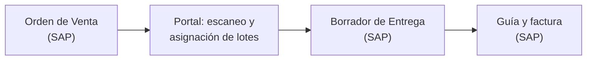
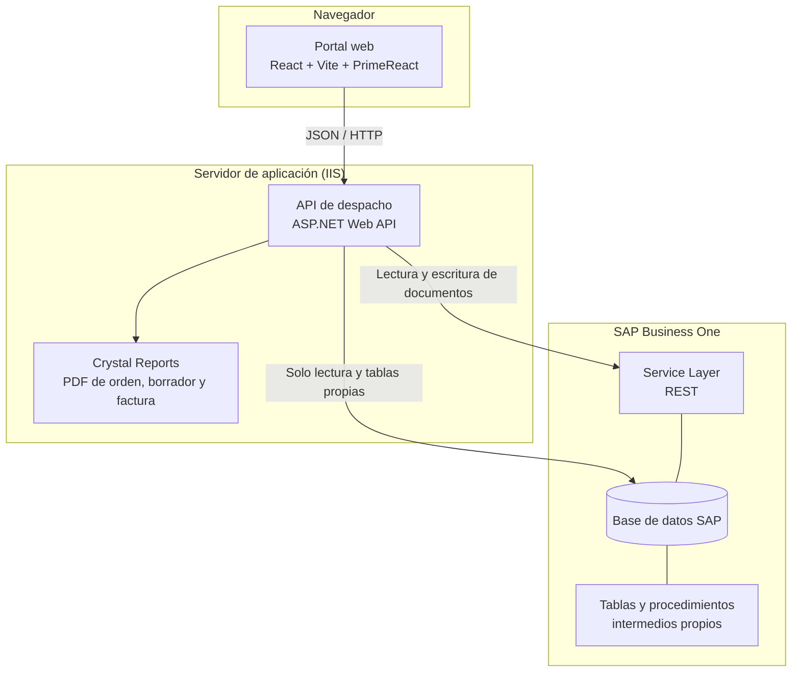
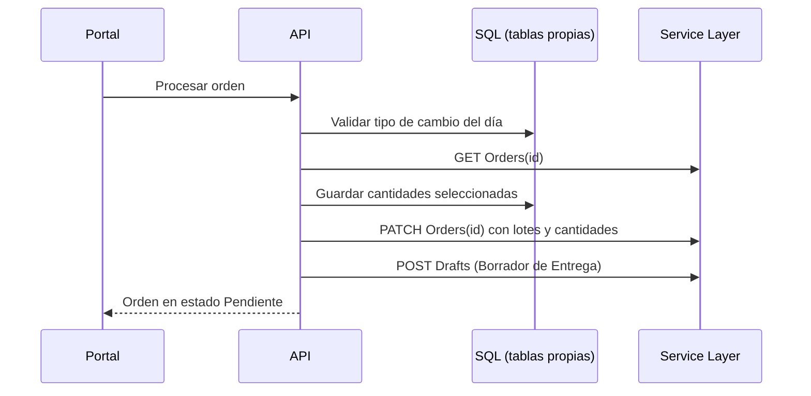

## Qué resuelve

SAP Business One no trae una pantalla de despacho por escaneo con control de lotes y cambio de lote en caliente. Este portal agrega esa capa **sin reemplazar a SAP**: SAP sigue siendo la fuente de verdad (órdenes, lotes, stock y documentos) y el portal solo orquesta lecturas y escrituras.

El personal de despacho toma una **Orden de Venta**, escanea cada producto, asigna el lote del que sale, registra la cantidad realmente despachada y quiénes hicieron el picking. Al terminar, el portal crea en SAP el **Borrador de Entrega**, que sigue su flujo hasta la guía y la factura.



| Acción en el portal | Objeto de SAP | Operación |
|---|---|---|
| Actualizar orden | Orden de Venta | `PATCH` de lotes y cantidades por línea |
| Procesar orden | Orden de Venta y Borrador | `PATCH` y `POST` del Borrador de Entrega |
| Cambio de lote (stock disponible) | Salida, entrada y traspaso de inventario | `POST` |
| Cambio de lote (tomar de la orden) | Orden de Venta, salida y entrada de inventario | `PATCH` y `POST` |

## Arquitectura



### Dos canales hacia SAP, con una regla clara

| Canal | Para qué se usa |
|---|---|
| **Service Layer (REST)** | Crear y modificar documentos de SAP respetando sus validaciones de negocio |
| **SQL directo (ADO.NET)** | Solo lectura de SAP (listados, lotes, stock, tipo de cambio) y escritura en **tablas propias** del proyecto |

**Regla de diseño: nunca se escribe en tablas de SAP por SQL.** Toda escritura sobre documentos pasa por Service Layer.

### Capas del backend

| Capa | Responsabilidad |
|---|---|
| Web API | Controladores HTTP, CORS y documentación Swagger |
| Negocio | Reglas de despacho e integración con SAP |
| Entidades | Objetos del portal y de Service Layer |
| Cliente de Service Layer | Sesión, reintentos y operaciones `GET`, `PATCH` y `POST` |
| Acceso a datos | ADO.NET para consultas y tablas propias |

## Modo demo

El portal incluye un **modo demo** que reemplaza al backend por datos ficticios con la misma forma de respuesta: 140 órdenes con razón social `DEMO - …`, vendedores y pickeadores inventados, 22 productos y lotes con el formato real de SAP. Sirve para presentaciones, capacitación y para generar la documentación.

Dos detalles de diseño:

- **Reproducible:** una semilla numérica hace que siempre se generen las mismas órdenes.
- **Muestra qué enviaría a SAP:** en modo demo, cada acción registra los mensajes exactos que el backend construiría, sin enviar nada. Eso permite documentar la integración con datos de prueba.

## Recorrido del portal

<figure>
  
  <figcaption>Inicio de sesión.</figcaption>
</figure>

### Listado de órdenes

Paginado en el servidor, con filtro de texto, chips de estado (*Abierto, Cerrado, Pendiente, Validado, Cancelado, Verificado*), rango de fechas y exportación a Excel de todas las páginas que cumplen el filtro.

<figure>
  
  <figcaption>Listado de órdenes con filtros, estados y acceso al PDF y al documento.</figcaption>
</figure>

### Pantalla de despacho

Al abrir una orden se muestran sus datos, la tabla de productos (con una fila hija por cada lote asignado), el panel de escaneo y los totales. Es obligatorio elegir al menos un pickeador para poder procesar.

<figure>
  
  <figcaption>Pantalla de despacho: datos de la orden, productos, escaneo y totales.</figcaption>
</figure>

### Escaneo con lotes

El campo de código acepta un lector de código de barras o escritura manual. El portal busca la línea que coincide y que todavía no está completa.

1. Se escanea el producto y el panel muestra fila, artículo, lote, unidad, disponible y cantidad.
2. Se elige el lote entre los que tienen stock. Si la orden ya tiene cantidad comprometida en un lote, se indica.
3. Se digita la cantidad y el lote se suma a la línea, con su barra de progreso.

<figure>
  
  <figcaption>Selección de lote: serie, vencimiento y stock disponible.</figcaption>
</figure>

<figure>
  
  <figcaption>Una línea completa muestra su progreso; si queda a medias aparece como incompleta.</figcaption>
</figure>

Para artículos sin lote existe un **modo automático**, que registra la cantidad sin pedir lote.

<figure>
  
  <figcaption>Modo automático para artículos sin lote.</figcaption>
</figure>

### Cambio de lote en caliente

Cuando el lote que SAP asignó ya no sirve (vencido, agotado o mal ubicado), el asistente de **cambio de lote** permite reemplazarlo sin salir del despacho. Cada escenario genera documentos de inventario distintos en SAP:

| Escenario | Cuándo se usa | Efecto en SAP |
|---|---|---|
| **Stock disponible** | Hay stock libre en otro lote del almacén principal | Salida del lote origen y entrada al lote destino; si la fila es del almacén secundario, además un traspaso |
| **Tomar de la orden** | Reasignar cantidad que la misma orden ya tiene comprometida en otro lote | Se resta la cantidad de la orden, más salida y entrada en el mismo almacén |

Reglas del asistente: hay que elegir lote origen y destino, **nunca se permiten lotes vencidos** y la cantidad no puede ser cero ni superar lo solicitado.

<figure>
  
  <figcaption>Cambio de lote con stock disponible.</figcaption>
</figure>

<figure>
  
  <figcaption>Cambio de lote tomando de lo comprometido en la misma orden.</figcaption>
</figure>

### Actualizar y procesar

- **Actualizar** guarda el avance en SAP sin cerrar el despacho, para no perder lo escaneado si se corta la jornada o si otro despachador continúa.
- **Procesar** cierra el despacho: valida los pickeadores, registra la hora de fin, envía todo a SAP y termina creando el Borrador de Entrega. Pide confirmación.

<figure>
  
  <figcaption>Confirmación antes de procesar.</figcaption>
</figure>

Tras procesar, la orden queda **Pendiente** y muestra el botón del Borrador de Entrega creado en SAP.

<figure>
  
  <figcaption>Órdenes pendientes, cada una con su Borrador de Entrega.</figcaption>
</figure>

### En el móvil

El diseño es adaptable: el riel lateral pasa a barra inferior y los bloques se apilan, con el escaneo primero.

<div class="trio">
  <figure></figure>
  <figure></figure>
  <figure></figure>
</div>

## Qué pasa en SAP al procesar una orden

El flujo de *Procesar* encadena lecturas, validaciones y escrituras, siempre por Service Layer para los documentos:



Ejemplo simplificado, con valores ficticios, de lo que se envía para crear el Borrador de Entrega. Cada línea apunta a su línea de origen en la orden y lleva los lotes con la cantidad que salió de cada uno:

```json
POST Drafts
{
  "DocObjectCode": "oDeliveryNotes",
  "CardCode": "C-DEMO-001",
  "DocumentLines": [
    {
      "BaseType": 17,
      "BaseEntry": 7138,
      "BaseLine": 0,
      "Quantity": 36,
      "BatchNumbers": [
        { "BatchNumber": "LOTE-A", "Quantity": 18, "BaseLineNumber": 0 },
        { "BatchNumber": "LOTE-B", "Quantity": 18, "BaseLineNumber": 0 }
      ]
    }
  ]
}
```

## Decisiones técnicas

- **SAP como fuente de verdad.** El portal no guarda copias permanentes de las órdenes: solo el avance del despacho y una foto original de la orden.
- **Escritura solo por Service Layer.** Así se respetan las validaciones de negocio de SAP y no hay riesgo de dejar documentos inconsistentes.
- **Las líneas se identifican por número de línea, no por artículo.** Un mismo artículo puede repetirse en varias líneas de una orden.
- **Solo viaja lo despachado.** Las líneas con cantidad cero no entran al Borrador y los lotes con cantidad cero no se reenvían.
- **Sesión con Service Layer resiliente.** Hasta 3 intentos con espera; ante una sesión vencida o una conexión cortada, vuelve a iniciar sesión y reintenta.
- **Reemplazo de colecciones en `PATCH`.** Se usa la cabecera de SAP que reemplaza las colecciones enviadas; por eso, al enviar los lotes de una línea, SAP sustituye todos los lotes de esa línea por los enviados.
- **Sin tipo de cambio del día no se escribe nada en SAP**, ni al actualizar, ni al procesar, ni al traspasar.
- **Dos almacenes.** Los lotes que dejan de usarse en el secundario retornan al principal.
- **El responsable queda registrado.** Cada movimiento lleva en SAP al usuario del portal que lo hizo, mediante campos de usuario.

### Manejo de errores de SAP

| Situación | Qué hace el sistema |
|---|---|
| El lote ya no existe o está agotado (error `480000112`) | Si falla el `PATCH` masivo, **reintenta línea por línea**. Las líneas válidas quedan aplicadas, se informa exactamente qué línea y lote falló, y no se crea el Borrador hasta corregirlo |
| Cantidad del lote ya comprometida (error `10001152`) | Mensaje claro con artículo y lote para que el usuario decida si cambia lo comprometido |
| Stock insuficiente (error `10001153`) | Diálogo con el artículo y el lote, y un botón **Ir al producto** para cambiar de lote |
| Tipo de cambio del día sin cargar | Se bloquea la operación con un mensaje claro |
| Sesión de Service Layer vencida | Nuevo inicio de sesión automático y hasta 3 reintentos |

### Trazabilidad

El backend escribe dos archivos de registro por día: uno con **cada llamada a Service Layer** (URL, JSON enviado y respuesta de SAP) y otro con las trazas de negocio, que indican qué líneas y lotes se cambian, se remueven o retornan. Es la herramienta principal para diagnosticar cualquier diferencia entre lo que el portal envió y lo que SAP aplicó.

## Stack

React 18 · Vite · PrimeReact · Axios · ASP.NET Web API (.NET Framework) · RestSharp · ADO.NET · SAP Service Layer · SAP Business One (HANA y SQL Server) · Crystal Reports · IIS
